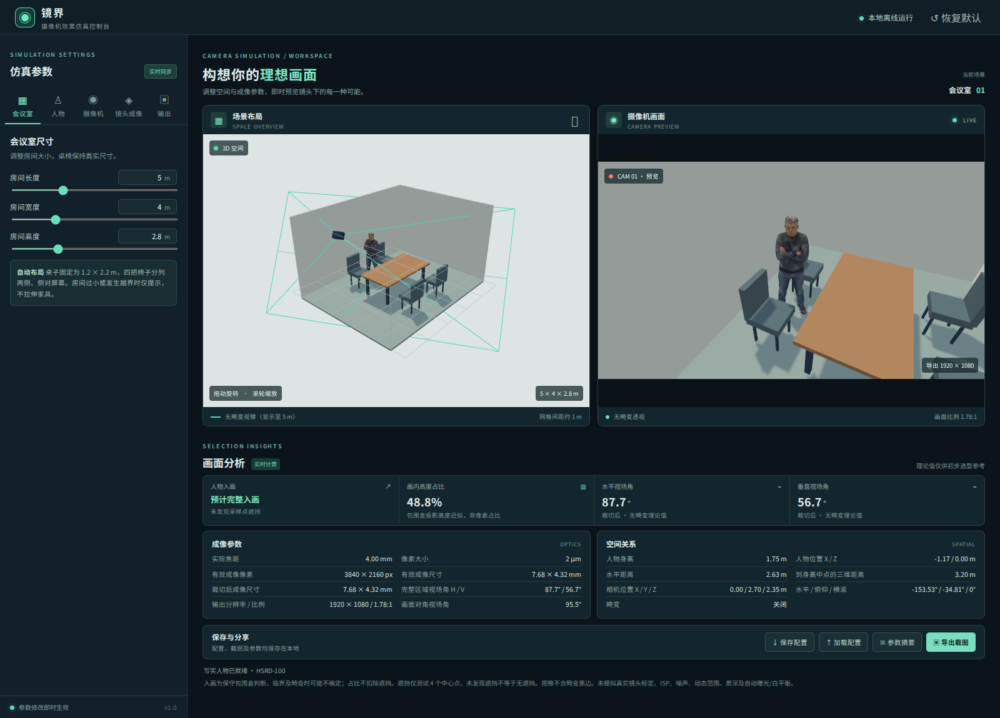

# 镜界 · 摄像机效果仿真

[](https://github.com/xiaoqinxing/camera-simulation/actions/workflows/ci.yml)

> **把会议室、人物和镜头装进浏览器：选一面墙、摆好位置、调准焦距，30 秒看清一台摄像机到底能拍到什么。**

镜界是一个运行在浏览器里的 Three.js 摄像机仿真控制台，面向会议室摄像机的**方案演示与初步选型**。左侧改参数，右侧即时看到 3D 空间布局和镜头画面；人物、纹理、字体、模型全部随包提供，没有 CDN、在线字体、在线模型服务或外部接口。

**[▶ 在线体验](https://camera-simulation.li.qinxing.xyz/)** ｜ [GitHub Pages 镜像](https://xiaoqinxing.github.io/camera-simulation/) ｜ [零安装运行](#方式一零安装预构建静态包) ｜ [源码运行](#方式二源码开发) ｜ [部署](#方式三部署到自己的服务器)



---

## 为什么值得一试

| 亮点 | 你能得到什么 |
| --- | --- |
| 🎥 **双视图联动** | 3D 空间布局与摄像机画面同屏对照，视锥、人物位置和最终构图一眼看清。 |
| 🧭 **四面墙一键机位** | 屏幕墙 / 对面墙 / 左墙 / 右墙顶部中央快速切换，自动对准人物中点，也可随时手动微调。 |
| 🔭 **按真实光学参数计算** | 输入像素大小、有效成像像素和实际焦距，自动互算水平 / 垂直 / 对角视场角，并处理输出比例不一致时的中心裁切。 |
| 🌗 **桶形 / 枕形畸变** | 简化径向模型实时预览，负 `k1` 桶形、正 `k1` 枕形，越界采样显示为黑边。 |
| 📐 **实时画面分析** | 人物是否完整入画、画内高度占比、视场角、遮挡采样结果同步更新。 |
| 🖼 **1080P / 4K 导出** | 预览按窗口自适应，导出按独立分辨率离屏渲染；另有 JSON 配置和 UTF-8 参数摘要。 |
| 🔒 **本地优先** | 所有计算和导出都在浏览器完成；本地静态包运行时不需要 Node.js，也不访问互联网。 |
| 🧍 **写实人物资产** | 内置 HSRD-100 全身扫描人物，站姿、真实比例，方便判断构图和遮挡。 |

---

## 快速开始

### 在线体验

打开 **<https://camera-simulation.li.qinxing.xyz/>** 即可。首次需要下载约 2.7 MB 的人物模型；页面本身不请求任何第三方资源。

> 在线访问需要网络才能从服务器获取静态资源。需要真正脱离网络使用时，请使用下面的预构建静态包。

### 方式一：零安装（预构建静态包）

已构建的 `dist/`（或发布包 `release/camera-simulation-static.zip` 解压后的目录）是完整的静态站点。把它复制到目标机器，用任意本机静态文件服务打开即可，**不需要 Node.js / npm，也不需要互联网**：

> `dist/` 和 `release/` 都是构建产物，不进入 Git；从源码开始请先执行 `npm run build`，修改后需要重新构建和打包。

```bash
# 在 dist/ 目录内执行
python3 -m http.server 8080 --bind 127.0.0.1
```

Windows 可使用：

```powershell
py -3 -m http.server 8080 --bind 127.0.0.1
```

然后访问 <http://127.0.0.1:8080/>。没有 Python 时，可使用机器上已有的其他静态服务；不要使用 `npx serve`，因为它可能尝试联网。

> **不要双击 `index.html` 用 `file://` 打开。** 浏览器的模块和模型加载限制会导致页面无法正常工作。
>
> 预构建包只包含网页资源，不包含操作系统、浏览器或 Python 安装包。目标机器需已具备支持 WebGL 2 的 Chrome / Edge 和本地静态服务。

### 方式二：源码开发

需要 Node.js 18.18+（推荐 20 LTS）和 npm：

```bash
npm ci          # 首次安装依赖需要网络，之后可断网
npm run dev     # 启动开发服务器，终端会显示本地地址
npm run build   # 生成可部署的 dist/
npm run preview # 本地检查构建结果
npm run test    # 计算与配置单元测试
```

### 方式三：部署到自己的服务器

在能通过 SSH 免密登录目标服务器的 Linux / WSL 环境执行：

```bash
npm run deploy
```

脚本会依次构建、备份线上目录、同步 `dist/`、规范权限，并检查首页、JS/CSS 和人物模型是否可访问。默认目标为 `https://camera-simulation.li.qinxing.xyz/`，可用环境变量覆盖：

```bash
DEPLOY_HOST=root@server \
DEPLOY_PATH=/srv/camera-simulation \
DEPLOY_URL=https://example.com/ \
npm run deploy
```

常用选项：

```bash
npm run deploy -- --skip-build   # 跳过构建，直接部署现有 dist/
npm run deploy -- --prune        # 让线上目录与 dist/ 完全一致（执行前仍会备份）
```

部署脚本依赖 `bash`、`ssh`、`rsync`、`curl` 和 `md5sum`。

### 方式四：GitHub Actions 自动部署

推送到 `master` 后，GitHub Actions 会并行执行三条流水线：

| 工作流 | 触发 | 作用 |
| --- | --- | --- |
| `.github/workflows/ci.yml` | push / PR | 单元测试、生产构建、Playwright E2E |
| `.github/workflows/pages.yml` | push `master` | 构建并发布到 GitHub Pages |
| `.github/workflows/deploy.yml` | push `master` | 构建并通过 SSH 同步到自有服务器 |

两个部署地址：

- GitHub Pages：<https://xiaoqinxing.github.io/camera-simulation/>
- 自有站点：<https://camera-simulation.li.qinxing.xyz/>

自有站点部署需要仓库 Actions secrets：

| Secret | 内容 |
| --- | --- |
| `SSH_PRIVATE_KEY` | 可登录 `root@qinxing.xyz` 的部署私钥 |
| `SSH_KNOWN_HOSTS` | `qinxing.xyz` 的 SSH 主机公钥（`ssh-keyscan -t ed25519 qinxing.xyz`） |

首次启用 Pages 时，在仓库 **Settings → Pages** 将 Source 设为 **GitHub Actions**。两个部署工作流也都支持在 Actions 页面手动 `Run workflow`。

---

## 三分钟上手

1. **选房间** — 在「会议室」页调整长、宽、高。桌子固定为 1.2 × 2.2 m，四把椅子分列两侧、侧对屏幕墙；房间过小只会提示，不会拉伸家具。
2. **放人物** — 在「人物」页设置身高，或用「人物水平距离」沿当前视线移动人物。人物始终等比例缩放，并只在水平面内转向摄像机。
3. **定机位** — 在「摄像机」页点击「屏幕墙 / 对面墙 / 左墙 / 右墙」快速落到墙顶中央，自动对准人物中点；之后可手动修改坐标、水平旋转角和俯仰角。
4. **调镜头** — 在「镜头成像」页输入像素大小、有效成像像素和实际焦距。修改焦距或水平 / 垂直视场角会自动同步其余参数。
5. **看结果** — 下方「画面分析」实时显示是否入画、画内高度占比和视场角；布局视图中的青色视锥表示无畸变取景范围。
6. **导出** — 右下角可保存 JSON 配置、加载配置、生成参数摘要，或按「输出」页的分辨率导出 PNG。

数值框输入后按 **Enter** 或移出焦点提交；超出范围的输入不会应用，并会给出提示。

### 界面速览

| 区域 | 用途 |
| --- | --- |
| 左侧参数栏 | 会议室、人物、摄像机、镜头成像、输出五组参数，修改即时生效。 |
| 场景布局 | 可拖动旋转、滚轮缩放的 3D 视图；隐藏靠近观察者的墙，显示远侧墙、家具和视锥。 |
| 摄像机画面 | 按当前镜头参数和输出比例渲染的实时预览，可带畸变黑边。 |
| 画面分析 | 人物入画、画内高度占比、水平 / 垂直视场角，以及成像和空间关系明细。 |
| 保存与分享 | 保存 / 加载配置、导出参数摘要、导出 PNG 截图。 |

---

## 参数与计算

### 光学与视场角

- 有效成像尺寸 = `像素大小 × 有效像素数`。例如 2 μm、3840 × 2160 得到 7.68 × 4.32 mm。
- 实际焦距 `f` 对应的无畸变视场角为 `2 × atan(成像尺寸 / (2f))`。
- 输出比例与有效成像比例不同时采用**中心裁切**，不拉伸画面；界面会同时显示完整区域和裁切后的视场角。
- 这里使用的是**实际焦距**，不是 35 mm 等效焦距。
- 修改焦距或水平 / 垂直视场角会互算其他参数；改变传感器或输出时保留实际焦距。

验收样例：**2 μm、3840 × 2160、4 mm → 7.68 × 4.32 mm，水平 87.66°、垂直 56.74°**。

### 坐标与机位

- 原点位于房间地面中心：X 为宽度，Z 为长度，Y 向上。
- 水平角 `0°` 指向 `+Z`，正角朝 `+X`；俯仰角正值向上，横滚固定为 `0°`。
- 墙面机位位于墙面水平中心、向室内 0.15 m、顶部下方 0.1 m，并自动对准人物中点。
- 默认机位在屏幕墙（`+Z`，带显示屏的墙）顶部中央，默认房间下为 `X=0、Y=2.7、Z=2.35 m`。
- 「对准人物」是一次性操作；之后手动调整的角度不会被覆盖。「恢复相机」回到当前房间的屏幕墙机位，并恢复默认镜头、畸变和输出设置。

### 畸变模型

采用简化径向模型：

```text
x_d = x(1 + k1·r²)
y_d = y(1 + k1·r²)
r²  = x² + y²
```

负 `k1` 为桶形趋势，正值为枕形趋势；关闭或 `k1 = 0` 时为无畸变。着色器对输出坐标反向采样，无法采样的部分显示黑色。系统会拒绝在当前视场内径向映射失去稳定性的强桶形组合。

该模型不是真实镜头标定，也不模拟鱼眼专用投影。

### 分析口径

- **入画**：人物三维包围盒投影到画面后的垂直范围，完全在画内才提示「预计完整入画」；临界情况显示保守估计，开启畸变后显示不确定。
- **画内高度占比**：包围盒投影的垂直高度范围裁切到画内后除以画面高度，不是人体像素面积，也不扣除遮挡。
- **遮挡**：仅沿人物身高中线的 4 个点发射射线检测墙和家具。它可能漏掉局部遮挡，也可能把中心线误判为人体表面；**未发现采样点遮挡 ≠ 完全无遮挡**。
- 视觉画面才是主要参考，分析数字用于快速比较和初步判断。

---

## 导出与配置

| 操作 | 产物 | 说明 |
| --- | --- | --- |
| 保存配置 | `摄像机配置.json` | 完整参数，可再次加载。 |
| 加载配置 | — | 完整校验成功后一次性恢复；文件上限 1 MB。 |
| 参数摘要 | `摄像机参数摘要.txt` | UTF-8 文本，包含当前画面评估结果。 |
| 导出截图 | `摄像机画面.png` | 按「输出」页分辨率离屏渲染，包含畸变，不含布局辅助线。 |

预览和导出使用同一套相机投影，但分辨率独立：

- 预览按面板尺寸 × 设备像素比实时渲染，像素比上限 1.5。
- 导出按「输出」页像素尺寸创建独立离屏缓冲；1080P 使用 4× MSAA，4K 使用 2× MSAA。
- 导出时阴影贴图临时提升到 2048，完成后恢复预览设置。
- 4K 导出在集成显卡上可能需要数秒，截图尺寸还受 GPU 最大纹理 / 渲染缓冲大小限制。

常用分辨率：`1920 × 1080`、`3840 × 2160`、`1600 × 1200`、`1080 × 1080`。

---

## 常见问题

**为什么画面比例变了，视野好像被裁掉了？**
输出比例与传感器比例不同时采用中心裁切，而不是拉伸。界面会同时显示完整区域视场角和裁切后视场角。

**为什么人物占比和肉眼感觉不一样？**
占比基于人物三维包围盒的垂直投影高度，比身体轮廓更保守，并且不扣除遮挡。

**为什么开启畸变后边缘有黑边？**
畸变采用反向采样；桶形畸变会把采样坐标推出原始画面边界，越界部分即显示为黑色。

**为什么不能直接双击 `index.html`？**
浏览器会限制 `file://` 下的模块和模型加载。请用本机静态服务访问 `http://127.0.0.1`。

**本地运行真的完全离线吗？**
预构建静态包在运行时不需要互联网，也不请求第三方资源。但目标机器仍需已有浏览器和静态文件服务；项目不提供操作系统、浏览器或 Python 的离线安装包。

**人物加载很久 / 失败怎么办？**
首次需要加载约 2.7 MB 的 GLB 人物模型。确认静态服务正常、`assets/hsrd-hsr0040-body-023-web.glb` 可访问，且页面不是通过 `file://` 打开。

**这是相机实测或画质评测工具吗？**
不是。它用于效果演示和初步选型，理论视场角不等于真实相机实测值。

---

## 精度与限制

- 不模拟真实镜头标定、ISP、binning、非中心裁切、噪声、动态范围、景深、自动曝光、自动白平衡或真实人像画质。
- 极宽视场下直线透视不能代表鱼眼镜头；超过 120° 时界面会给出提示。
- 人物占比、入画和遮挡均为包围盒 / 采样点近似判断，临界和畸变情况下可能不确定。
- 家具与人物可能重叠、遮挡或移出画面；布局视图只做提示，不自动重排。
- 预览和导出受浏览器、显卡驱动、显存和最大纹理尺寸影响。

<details>
<summary><b>验证记录（点击展开）</b></summary>

**2026-10-29，Ubuntu 24.04 / Node 18.19.1 / Playwright Chromium Headless 141（SwiftShader）**

- `npm run build` 成功；10 项计算与配置单元测试通过。
- 浏览器测试覆盖模型与离线字体加载、参数交互、4:3 画面比例、手动角度保持、人物画外、焦距与 FOV 互改、距离与占比、配置保存 / 加载、PNG 尺寸、摘要导出、畸变前后 PNG 一致性。
- 对 `release/camera-simulation-static.zip` 解压后用 Python 本地服务运行，并阻断非本机请求，记录到的外部请求为零。

**2026-11-04，补充验证**

- 4K UHD 导出 PNG 为 3840 × 2160，导出期间预览尺寸仍远低于 1080P；默认 1080P 导出与畸变前后一致性用例保持通过。
- 新增 `npm run deploy` 并验证构建、备份、rsync、权限规范化和 HTTP 校验。
- 默认机位改为屏幕墙顶部中央；四个墙面机位随房间尺寸重算，手动修改坐标后取消高亮。
- `npm run test` 15 项通过，`npm run test:e2e` 4 项浏览器测试通过。

**尚未覆盖**：Windows 10/11、桌面版 Chrome / Edge、真实 GPU、其他屏幕尺寸的手工验收和性能基准；目标平台支持仍需在目标设备上复验。

</details>

---

## 开发说明

### 目录结构

```text
src/core.ts          纯计算：光学、距离、机位、校验、摘要
src/scene.ts         Three.js 场景、渲染、畸变着色器、导出
src/main.tsx         React 控制台界面
src/style.css        界面样式
public/assets/       写实人物 GLB
public/licenses/     人物、字体及第三方许可
scripts/deploy.sh    构建产物部署脚本（手动部署）
.github/workflows/   CI、GitHub Pages 与自有站点自动部署
scripts/optimize-model.mjs  人物模型压缩与纹理重编码
tests/core.test.ts   Vitest 计算测试
tests/e2e/app.spec.ts Playwright 浏览器测试
```

### 测试

```bash
npm run test       # 计算与配置测试
npm run test:e2e   # 浏览器端测试，需要 Playwright Chromium
```

首次运行浏览器测试需要安装 Chromium：

```bash
npx playwright install --only-shell chromium
```

测试不属于应用运行时，首次安装需要网络。测试机缺少 `libasound.so.2` 时，可安装系统相应包后重试。

### 重新生成人物模型

`public/assets/` 中的 GLB 由 `source-assets/` 的原始模型生成：纹理由 8K 缩至 3072 × 3072 并重新编码 JPEG，几何数据做量化和 Meshopt 压缩，三角面数不变。

```bash
npm run optimize:model
```

脚本会先校验源文件 SHA-256，校验失败会中止。

### 技术栈

React 18 · Three.js 0.180 · TypeScript 5 · Vite 6 · Vitest · Playwright · Meshopt · Sharp

---

## 人物资源与许可

随应用附带的 `public/assets/hsrd-hsr0040-body-023-web.glb` 来自 Digital Reality Lab / HumanScanRepository 的 [HSRD-100](https://huggingface.co/datasets/digitalrealitylab/HSRD-100) `HSR0040-Body-023` 写实全身扫描（Lichtwerk Studio 转换版），遵循 **CC BY 4.0**。分发和修改需保留署名、许可和修改记录；原作者伦理说明包括不用于监控、生物识别等用途。

- 模型：约 10 万面、站姿、原始高度 1.75 m、模型朝 `+Z`
- 压缩版 SHA-256：`6bcf701f9d38e30b31fad52fe5c00645275a3ce0aab20ae19b06d382f82ed78f`
- 原始 GLB 位于 `source-assets/`，SHA-256：`535bc52e341b02fb135992ad21e880a748a1bd79ac10c87849e78492a5fd55a3`

完整许可、转换记录、来源和第三方声明见 `public/licenses/`。字体使用 Noto Sans SC，遵循 SIL Open Font License。

计算参考：[Edmund Optics — Understanding Focal Length and Field of View](https://www.edmundoptics.com/knowledge-center/application-notes/imaging/understanding-focal-length-and-field-of-view/)、[Three.js PerspectiveCamera](https://threejs.org/docs/pages/PerspectiveCamera.html)、[OpenCV 相机标定](https://docs.opencv.org/5.0/tutorials/calib3d/camera_calibration/camera_calibration.html)。
